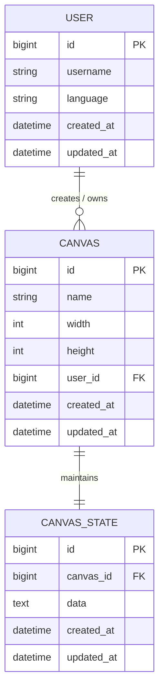

# CoCanvas - Real-Time Collaborative Drawing Application

- **Unit**: Web System Development (`WDE`)
- **Study Period**: Fall 2025
- **Degree Programme**: Master of Computer and Information Sciences — Hosei University

A minimalist, high-performance real-time collaborative canvas web application built with **Ruby on Rails 7**. Multiple users can paint and sketch concurrently on shared digital canvases with sub-second WebSocket synchronization and zero registration friction.

---

## Features

- **Real-Time Collaboration**: Sub-second drawing synchronization across browsers powered by ActionCable WebSockets.
- **Multi-Canvas Workspace**: Create, configure dimensions (width &times; height), rename, and delete multiple digital canvases.
- **Persistent State Storage**: Canvas pixel states are serialized as Base64-encoded PNG data URLs and stored directly in database.
- **Frictionless Anonymous Sessions**: Automatic session-based user provisioning with customizable display names and zero login gates.
- **Bilingual Internationalization (i18n)**: Native English and Japanese localization with client-side browser timezone awareness.
- **High-DPI 2&times; Rendering**: Native Retina/high-DPI canvas backing store with CSS layout scaling to ensure crisp vector-like brush strokes.
- **Minimalist Aesthetic**: Distraction-free, typography-first interface with zero heavy frontend framework overhead.

---

## Architecture and Database Schema



### Technical Design Decisions

1. **Stateless Session Identity**:
   User contexts are maintained transparently via Rails encrypted session cookies. If a session does not have an associated record, `ApplicationController#ensure_user` provisions an anonymous identity without interrupting the user journey.
2. **WYSIWYG Bitmap Synchronization**:
   Rather than complex vector diffing algorithms, CoCanvas serializes canvas bitmap representations to ensure exact visual parity across varying browser rendering engines.
3. **High-DPI Canvas Scaling**:
   Canvas elements initialize with an internal resolution multiplied by `window.devicePixelRatio` ($2\times$ scale), scaled down using CSS styling to eliminate edge blur on modern high-resolution displays.
4. **WebSocket Broadcast Protocol**:
   Local strokes trigger an asynchronous snapshot on pointer-up, persisting to the backend REST API (`/api/canvas/save`) while simultaneously streaming updates through `CanvasChannel` to all active subscribers.

---

## Repository Structure

```text
WDE-CoCanvas/
├── app/
│   ├── channels/
│   │   └── canvas_channel.rb          # ActionCable WebSocket channel for drawing broadcasts
│   ├── controllers/
│   │   ├── api/canvas_controller.rb   # REST API for canvas state persistence (load/save/clear)
│   │   ├── application_controller.rb  # Session management, locale setup & user provisioning
│   │   ├── canvases_controller.rb     # Canvas CRUD and member operations
│   │   └── home_controller.rb         # Workspace dashboard & user settings
│   ├── javascript/
│   │   ├── channels/canvas_channel.js # Client-side WebSocket consumer
│   │   └── controllers/
│   │       └── canvas_controller.js   # Stimulus JS controller for drawing, DPI scaling & sync
│   ├── models/
│   │   ├── canva.rb                   # Canvas entity model
│   │   ├── canvas_state.rb            # Serialized PNG state storage
│   │   └── user.rb                    # User identity & preferences model
│   └── views/                         # Minimalist HTML/ERB templates
├── config/
│   ├── routes.rb                      # Application endpoints and WebSocket mounting
│   └── locales/                       # English (en.yml) and Japanese (ja.yml) dictionaries
├── db/migrate/                        # Relational database migration scripts
├── Dockerfile                         # Production-grade multi-stage container build
└── README.md                          # Project documentation
```

---

## Getting Started

### Prerequisites

- Ruby 3.3+
- Bundler
- SQLite3 (default development) or PostgreSQL (production)

### Installation & Local Run

1. **Install dependencies**:
   ```bash
   bundle install
   ```

2. **Run database migrations**:
   ```bash
   bin/rails db:prepare
   ```

3. **Start the local server**:
   ```bash
   bin/rails server
   ```
   Navigate to `http://localhost:3000`. Open multiple browser tabs to test real-time collaboration.

### Containerized Deployment (Docker)

```bash
docker build -t cocanvas .
docker run -p 3000:3000 -e RAILS_MASTER_KEY=<your-key> cocanvas
```

---

## Portfolio note

This Git repository was created retrospectively from the original project code, with assistance from OpenAI Codex and Antigravity in curating the repository and writing this README for publication. The initial commit timestamp is backdated to the original coursework submission date, followed by the final release commit.
